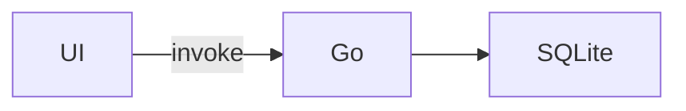

# burrow-visuals

A Burrow chat draws three kinds of fenced code block natively. `visual` and
`questions` hold **one JSON object** and nothing else; `mermaid` holds mermaid
source. Invalid JSON is shown as a plain code block, so
check your JSON before you send it.

They only render in a Burrow **chat** (`BURROW_CHAT_ID` is set). A Burrow
terminal tab (`BURROW_PTY_ID` set) shows them as raw JSON, so don't use them there.

Don't repeat in prose what the visual already shows. Add only what it doesn't
show: the conclusion, a caveat, the next step.

## ```visual

The block is one of:

- **A chart**: a Vega-Lite-style spec with a top-level `"mark"`.
- **A composition**: `{"title"?: "…", "rows": [part, …]}`, drawn top to
  bottom. A part is one of the following, and any part may have `"title"`:
  - `{"chart": <chart spec>}`
  - `{"stats": [{"label": "…", "value": 42, "note"?: "…", "tone"?: "good" | "bad"}]}`
  - `{"table": {"columns": ["…"], "rows": [["…", 1], …]}}`. Rows may also be
    objects keyed by column name, and then `columns` is optional.
  - `{"text": "markdown"}`
  - `{"columns": [part, …]}`: parts side by side
  - `{"page": {"title": "…", "path": "…", "description"?: "…"}}`: a card with
    an Open button for an HTML page you wrote (see below)

### Chart subset

- `mark`: `bar`, `line`, `area`, `point`, or `arc` (pie). Use
  `{"type": "arc", "innerRadius": 50}` for a donut and
  `{"type": "line", "point": true}` for a line with dots.
- `data`: always inline, as `{"values": [{…}, …]}`.
- `encoding`:
  - `x` and `y`, each `{"field": "…"}`. `y` must be numeric.
  - optional `color: {"field": "…"}`. It splits the data into series
    (grouped bars or several lines) with a legend.
  - for `arc`, use `theta: {"field": "…"}` with `color: {"field": "…"}`.
- `title` and `height` (pixels, default 220) are optional.
- `x` is treated as categories: values are spaced evenly in data order. Sort
  the data the way you want it drawn. A true scatter plot is not supported.

```visual
{"title": "Test run", "rows": [
  {"stats": [{"label": "Passed", "value": 412, "tone": "good"}, {"label": "Failed", "value": 3, "tone": "bad"}, {"label": "Duration", "value": "48 s"}]},
  {"chart": {"title": "Failures by package", "mark": "bar",
    "data": {"values": [{"pkg": "api", "n": 2}, {"pkg": "ui", "n": 1}]},
    "encoding": {"x": {"field": "pkg"}, "y": {"field": "n"}}}}
]}
```

## ```mermaid

Use it for structure prose explains badly: a flow or state machine, a sequence
of calls between components, an ER model, a dependency graph. Not for data
(use a chart) and not for a list of steps (use a list). Keep it small, a dozen
nodes or so; plain labels only (no HTML in labels). Invalid source is shown as
a code block.



## Page cards

For a mockup or a small interactive tool, write **one self-contained HTML
file** (inline CSS and JS; images as `data:` URLs) and link it with a page
part. Put it under `$BURROW_SESSION_DIR` unless it belongs in the project. The
path is absolute or relative to the chat's working directory and must end in
`.html`.

```visual
{"rows": [{"page": {"title": "Settings mockup", "description": "Two layouts side by side", "path": "/abs/path/settings.html"}}]}
```

The page opens in a sandbox: scripts run, but it has **no network at all**
(no fetch, no CDN scripts or fonts, no form posts) and no access to the app.

## ```questions

Use this when you need the user's decisions, especially on several questions
at once. The user sees a form: clickable options for each question, an
"Other / note" field under each one, a notes box, and Send / Skip all
buttons.

```questions
{"questions": [
  {"header": "Storage", "question": "Where should drafts be saved?",
   "options": [{"label": "SQLite", "description": "Survives restarts", "recommended": true}, {"label": "localStorage"}]},
  {"question": "Which platforms need it?", "multiSelect": true,
   "options": ["Desktop", "Phone"]},
  {"question": "Name for the setting?", "options": []}
]}
```

- An option is a string, or `{"label", "description"?, "recommended"?}`. Mark at most one
  option per question as recommended.
- A question with `"options": []` is free text.
- End your turn after the block and wait for the user. The answer arrives as
  your next user message, in this shape:
  `Answers:\n1. <question>\n   → <choices>`. `(skipped)` means the user left
  that question blank, so decide it yourself and don't ask it again.
